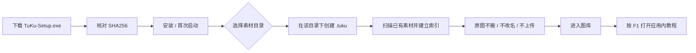
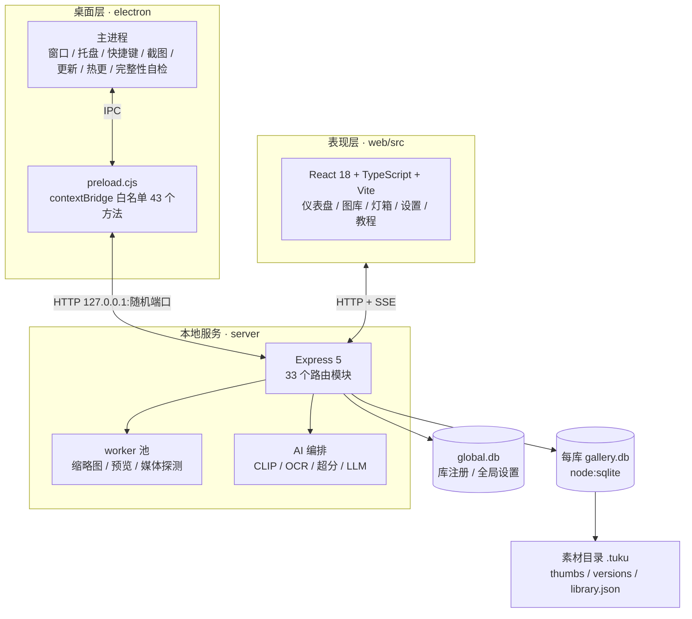

# 图库 TuKu

[](https://github.com/mr-awei/youyouvault/releases/latest)
[](#2-下载与安装)
[](#7-架构与数据流)
[](#9-常用命令)
[](LICENSE)

**本地优先的图片 / 素材管理器。** 原图留在你自己的硬盘上，索引、标签、评分、笔记、缩略图全部存在本地；不注册账号、不上传云端、断网照样能用（AI 大模型除外，可接本地 Ollama）。

> 仓库同时镜像在 [GitHub](https://github.com/mr-awei/youyouvault) 与 [Gitee](https://gitee.com/mr-awei/youyouvault)。整包自动更新只读 GitHub Releases；Gitee 只做代码镜像与热更镜像。
>
> - 面向普通用户的功能介绍：[`docs/产品介绍.html`](docs/产品介绍.html)（[English](docs/产品介绍.en.html)）
> - 授权签发 / 停用 / 排查：[`docs/授权管理.md`](docs/授权管理.md)
> - 应用内教程：运行后按 `F1`，内容随版本更新、不依赖网络

---

## 目录

| | | |
| --- | --- | --- |
| [1 它是什么](#1-它是什么) | [2 下载与安装](#2-下载与安装) | [3 五分钟上手](#3-五分钟上手) |
| [4 功能总览](#4-功能总览) | [5 界面与快捷键](#5-界面与快捷键) | [6 授权与版本](#6-授权与版本) |
| [7 架构与数据流](#7-架构与数据流) | [8 数据与目录](#8-数据与目录) | [9 常用命令](#9-常用命令) |
| [10 验证与质量](#10-验证与质量) | [11 打包与发布](#11-打包与发布) | [12 开放接口与插件](#12-开放接口与插件) |
| [13 常见问题](#13-常见问题) | [14 边界与说明](#14-边界与说明) | [许可](#许可) |

---

## 1 它是什么

| | 图库 TuKu | 云盘 / 在线相册 | 纯文件夹 |
| --- | --- | --- | --- |
| 原图位置 | 自己硬盘，不搬不改名 | 服务商 | 自己硬盘 |
| 组织方式 | 多层文件夹 + 标签 + 堆叠 + 清单 + 智能文件夹 | 目录 / 相册 | 目录 |
| 检索 | 文件名 / 标签 / 描述 / OCR / 颜色 / 语义 / 相似图 / 混合排序 | 文件名 + 少量 AI | 文件名 |
| 编辑 | 裁切 / 调色 / 标注 / 擦除 / 超分 / 视频裁剪，非破坏可选 | 基础滤镜 | 无 |
| 离线可用 | 是（LLM 类能力可接本地 Ollama） | 否 | 是 |
| 百万级 | 是（实测百万行基准） | 依赖服务端 | 不可用 |
| 桌面集成 | 托盘 / 全局快捷键 / 截图入库 / 文件关联 / 开机自启 | 无 | 无 |

Windows 桌面端（Electron）＋ 本地服务（Node）＋ Web UI，同一套数据三种打开方式。面向**单机创作者与素材工作者**：不做账号体系、不做实时协同，把系统级集成与编辑产出做深。

**明确不做的**：在线图床、实时协同编辑、跨端行级合并、云同步（只做「同步文件夹 + 版本快照」）。跨平台（macOS / Linux）只保证「能启动并使用图库」，Win32 专属能力（OCR、部分硬件加速、托盘细节）会明确降级并说明原因。

---

## 2 下载与安装

从 [Releases](https://github.com/mr-awei/youyouvault/releases/latest) 下载 `TuKu-Setup-<version>.exe`（Windows 10/11 x64，NSIS 安装包）。

每个 Release 说明里都带有该安装包的 **SHA256**，下载后先核对：

```powershell
certutil -hashfile .\TuKu-Setup-1.7.0.exe SHA256
```

输出的哈希与 Release 说明里的一致才可以安装；不一致说明下载不完整或被替换，请重新下载。

- 安装到当前用户目录，**不需要管理员权限**；可选安装路径
- 桌面 / 开始菜单快捷方式名为「**优优图库**」；应用 ID `com.youyou.tuku.visual`，数据目录 `%APPDATA%\youyoutuku`，可与原始图库（TuKu）**并存安装**，不覆盖对方的安装、快捷方式与数据
- 安装版会接管常见图片 / 视频 / 音频的「打开方式」，双击图片即可用优优图库打开
- 首次启动选择一个素材文件夹建库，**原文件不动**
- 更新在后台静默检查与下载，下载完成后才提示：**立即安装并重启** / **下次打开时安装**
- 只改前端或服务端的补丁走**热更**通道，不必重装
- AI 能力按需下载模型（语义检索、超分运行库），不下也能用其余全部功能
- AI 超分 / 语义检索开跑前会检查 CPU、内存、显卡，不达标弹出对照表；勉强能跑的给「仍然继续」

> **如果 360 / 火绒 / Defender 提示风险**
>
> 本软件没有购买 Windows 代码签名证书，exe 属性里看不到可信发布者，安装包和主程序可能被提示「未知发布者 / 可疑程序」。这是未签名程序的常见情况，**不代表文件被篡改**。遇到时：
>
> 1. 只从本仓库 Releases 下载，用上面的 SHA256 核对，不要用第三方转载包；
> 2. 安装包被拦时选择「仍要运行 / 允许本次操作」，装完把安装目录加入安全软件的信任列表（**设置 → 关于软件 → 打开安装目录**）；
> 3. 如果某个功能异常、或设置页提示「文件缺失」，去 **设置 → 数据与维护 → 维护工具 → 软件完整性** 点「立即校验」：列出被隔离的文件，并可一键用已签名的增量补丁补回；
> 4. 也欢迎把误报提交给安全软件厂商，后续版本能更快脱离拦截名单。



---

## 3 五分钟上手

| 步骤 | 动作 | 结果 |
| --- | --- | --- |
| 1 建库 | 首次启动选素材目录（如 `D:\图片`） | 库数据写到该目录 `.tuku` 下，原图不搬不改名 |
| 2 找图 | 顶部搜索框吃文件名 / 标签 / 描述 / OCR；筛选栏叠加类型、星级、颜色、画幅 | 支持 `tag:` `color:` `rating:>=4` `folder:` `kind:video` `is:favorite` 前缀；语义搜索走「关键词 + 向量」混合排序 |
| 3 整理 | 勾选多张 → 底部批量条；拖图到左侧文件夹归档；拖标签到图片打标；按 `F` 快速分类 | 组织关系落库，不移动原文件 |
| 4 堆叠 | 多选后建堆叠，或把图片拖到组主卡片并入 | 一组算一条，可设封面、并入、解散 |
| 5 编辑 | 单击进大图，`←` `→` 翻页，`1`~`5` 打星；「更多」里有裁切、调色、标注、擦除、非破坏编辑 | 默认非破坏：先记操作链，确认后「应用到底片」才写回原图 |
| 6 查教程 | `F1`，输入「堆叠」「时间点笔记」「导出」 | 命中处高亮，内容随应用更新、不依赖网络 |
| 7 命令面板 | `Ctrl+K` | 跳转任意页面、新建窗口、导出画廊、切换主题、全选、清筛选 |

---

## 4 功能总览

共 14 个顶层页面：仪表盘、图库（含收藏）、条码入库、时间线、无限画布、整理、素材清单、AI 知识库、搜索、智能文件夹与标签、画质增强、教程、设置；外加灯箱、素材工具箱、调色台、对比 / 对决、堆叠查看器、批量裁切台等全屏浮层。

### 4.1 浏览与网格

- **三种展示**：瀑布流 / 网格 / 文件夹收纳（按夹分组铺图，含「未归档」入口）；缩略图五档预设 + 无级滑块，记忆为本地偏好
- **虚拟滚动**：只渲染视口附近的卡片，百万级列表滚动不卡；触底自动加载、滚动位置可恢复
- **卡片角标**：未看过圆点、色标、星级、堆叠 ×N、格式角标（VIDEO / AUDIO / 3D / PDF / DOC / PSD / RAW）、视频时长、重复 ×N、标注数、AI 低分警告
- **卡片悬停**：收藏、下载、进大图；鼠标移上去就预热预览图
- **右键菜单**（分组）：搜索命令…、大图预览、查看 / 解散堆叠、收藏、设为封面（视频取当前帧、字体取文字预览）、恢复默认缩略图、顺 / 逆时针旋转、编辑标签、下载、复制图片 / 路径 / 直链、在文件夹中显示、移到回收站
- **批量条**：下载 ZIP、导出、发送到画布、移出收件箱、收藏、对比（仅选 2 张）、快速分类、建堆叠、动作…、批量裁切、批量调色、批量改信息、批量重命名、OCR、删除；低频项收在「更多 ▾」，常用动作可自定义固定
- **详情浮层**：视频 / 音频、PDF、Office、EPUB、3D 模型、PSD、RAW、字体都能站内查看

### 4.2 搜索与筛选

- **搜索语法**：`tag:` / `color:` / `rating:>=4` / `folder:` / `kind:video` / `is:favorite` / `is:unseen`，可与关键词混写
- **筛选维度**：标签、收藏、横竖、已看、星级、类型、待整理、来源、分辨率档（sd / fhd / 2k / 4k）、12 段色相 + 黑白灰、精确色号（带容差、系统取色器）
- **排序 11 项**：最新入库、名称 A→Z / Z→A、推荐（偏好 + 评分）、我的星级优先、评分排序、低分优先、最早入库、分辨率最高、文件最大、随机；文件夹内另可手动排序
- **保存筛选器**：把当前搜索 + 筛选 + 排序存成「筛选现场」，侧栏一键回到现场，可编辑 / 覆盖 / 删除
- **三种专用搜索页**：语义搜索（CLIP 向量 / AI 抽词）、按图搜相似（pHash）、按色系搜
- **标记已看**：可把当前筛选结果整批标记为已看
- **截图入库**入口就在筛选栏（全局 `Ctrl+Shift+S`）

### 4.3 文件夹、标签与资源库

- **文件夹**：多层树、同父级拖动排序、重命名 / 删除、批量新建、拖素材归类、文件夹封面、外观（emoji + 主题色）、在系统资源管理器中打开
- **文件夹标签**：夹内搜索自动继承该夹标签
- **隐私空间**：单个文件夹可加密码（解锁 / 封存），库级也能加密码（锁定后整页只剩解锁屏，服务端对业务接口返回 423）
- **标签**：标签树分组折叠、分页加载、点标签即筛选、内联改标签、拖标签到卡片打标、批量新建
- **标签元信息**：分组、颜色、层级、排序；同义词 / 别名只影响搜索，不改写图片上的标签文字
- **资源库（多库）**：一个素材目录 = 一个库（`.tuku` 下有独立 `gallery.db`）；创建 / 切换 / 重命名 / 删除 / 加密库解锁；切库后文件夹树、保存筛选、URL 状态全部重建
- **多窗口**：`Ctrl+N` 再开一个窗口看同一份库（桌面端）

### 4.4 堆叠与笔记

- **堆叠**：多选建组、把图片拖到组主卡片并入、查看组内成员、重新指定组主、移出、并入其它堆叠、解散；网格里以「一组一条」展示并带 ×N 角标
- **文本笔记**：每张素材可挂多条笔记，可编辑、删除
- **时间点笔记**：视频 / 音频的笔记可钉在某个秒数，点击跳转到该帧

### 4.5 整理、查重与收件箱

- **待整理四入口**（侧栏带数量角标）：收件箱、未归文件夹、无标签、无评分，点一下就是对应筛选
- **整理页（Tidy）**：扫描范围可选「全库 / 当前筛选 / 仅选中」
  - MD5 完全重复：列出同内容不同文件，可逐组清理
  - pHash 相似重复：按相似组审查、合并
  - 二选一对决（Duel）与并排对比（Compare）
  - 一致性检查、孤儿缩略图
- **维护工具**（设置页）：重建缺失缩略图、按 EXIF 修复方向、清理孤立缩略图、压缩数据库、重新扫描目录、补算音视频时长 / 分辨率、清理幽灵文件夹、清理孤儿关联、XMP 元数据导入、缩略图失败队列（逐项重试 / 清空）
- **库健康**：外键约束检查、路径索引去重、孤儿行对账
- **回收站**：逐条恢复 / 永久删除、批量恢复 / 清空；删除时可选记「删除原因」，写进知识库

### 4.6 编辑、标注与增强

- **大图（灯箱）**：左右翻页、空格播放 / 退出、缩放、打星、详情面板、底部缩略图条、幻灯片；打开即预热前后张与高清图
- **裁切**：单张裁切（比例 / 尺寸 / 自动焦点），全屏批量裁切台
- **调色**：曝光、曲线、直方图、自动色调、预设观感；全屏调色台另有色轮 / 色板
- **标注**：画笔与图形标注层，撤销 / 重做，卡片显示标注数
- **擦除修复**：局部消除（inpaint）
- **非破坏编辑**：默认只记操作链（`edit_ops`），浏览 / 预览 / 下载 / 导出都按链渲染，确认后「应用到底片」才写回原图；可随时还原
- **素材工具箱 5 个页签**：检查器、OCR、版本历史、多区域裁切、修复
- **版本历史**：覆盖写回前自动备份原文件，可回滚；恢复时当前版本也会先备份
- **批量操作**：批量裁切、批量调色、批量改信息（星级 / 色标 / 收件箱 / 标签 / 备注）、批量重命名（模板）、批量 OCR
- **画质增强**：按标准（低于阈值自动收录）批量超分；内置模型逐个安装、AI 放大（Real-ESRGAN / CUGAN，ncnn + Vulkan）、Swin2SR（ONNX / CPU）、可接线上增强服务
- **视频 / 音频**：视频裁剪导出、转 GIF / WebM、抓当前帧作封面
- **色板**：从图片抽主色，导出 ASE 或 PNG 色卡
- **对比**：两张并排对比、二选一对决

### 4.7 导出与分享

- **单图导出**：尺寸 / 格式 / 质量可选
- **ZIP 批量下载**：≤500 张，可统一转码为 JPEG / PNG / WebP / AVIF
- **静态 HTML 画廊**：导出成可独立打开的网页相册（按文件夹或选中项）
- **Eagle 库导出**：生成 Eagle 可导入的包
- **元数据出口**：JSON（完整字段）、CSV（清单）
- **复制**：复制图片到剪贴板、复制文件路径、复制直链
- **原生拖拽导出**：把卡片直接拖到资源管理器 / 微信 / PS，落成真实文件
- **只读分享**（专业版）：生成带有效期 / 密码 / 禁下载的分享链接与二维码，手机浏览
- **手机扫码投送**（专业版）：同 Wi-Fi 下手机打开网页上传到当前库

### 4.8 导入与拍摄入库

- **本地导入**：拖入 / 粘贴 / 选择目录扫描；内容级去重（MD5）、命名模板、断点续传、冲突识别、导入进度可见、失败可续
- **目录监听**：指定文件夹，新文件自动导入（递归监听，自动排除回收站 / 缩略图 / `.tuku` / `.library`），可设最大目录深度 1–16
- **截图入库**：全局 `Ctrl+Shift+S` 区域框选，直接落进当前库
- **条码 / 编码分文件夹入库**（专业版，9 步向导）：
  1. 扫描（识别条码）
  2. 复核候选
  3. 补编号 / 解析编码
  4. 按编号重命名（可手动挑图、识别嵌套）
  5. 比例裁切（eBay 方形校验，可跳批量裁切台）
  6. 复制入库到「日期 / 编码」层级
  7. OMS 上传（登录 OMS，按 5 位主 SKU 取完整编码 + 产品图传 OSS）
  8. 报表
  9. 收尾（旧文件移到 `.stale`）
  - 该页面切走不卸载，后台继续跑
  - **eBay 产品**自己挑前五张并按所选顺序编号；非 eBay 产品跳过手选，按拍摄顺序自动编号
  - 产品名与编码写入标签
  - 工作报表可「复制成可直接粘进 Excel 的表格」
- **移动 / 手工上传**：支持把已入库图片移动到指定编码目录、手工选择文件夹补传

### 4.9 AI 能力

| 能力 | 跑在哪 | 说明 |
| --- | --- | --- |
| CLIP 语义搜索 | 本地 | 约 90MB ONNX 模型；英文语料，中文查询弱对齐；小库分桶扫描、大库 HNSW |
| 相似图 / 语义去重 | 本地 | CLIP 余弦 + pHash，可按阈值调 |
| OCR | 本地（仅 Windows） | 走系统 OCR 引擎，结果受系统语言包影响；其它平台返回不可用 |
| 画质分 / 主色 / 主体 | 本地 | 清晰度打分、主色提取、显著性主体检测 |
| 自动标签 / 描述 | 远程或本地 Ollama | OpenAI 兼容接口，支持多供应商配置档案 |
| 适配度评分 / 知识库 | 远程或本地 | 从「删除原因」反馈学习打分权重，`/api/kb/rescore` 重算 |
| 夜间批处理 | 远程或本地 | 设定时段自动跑 AI 批处理，导入进行中自动让路 |
| 超分 / 增强 | 本地 | Real-ESRGAN、CUGAN、Swin2SR；GPU 不可用时自动回落 CPU |

- **供应商**：内置 DeepSeek、OpenAI、通义千问（百炼）、智谱 GLM、Ollama 预设，也可填自定义 `baseUrl`；配置档案可保存多套并一键切换
- **多模型 / 视觉模型**：可手填模型名，也可从接口拉取模型列表；视觉模型单独选
- **离线**：不配任何 LLM 也能用浏览、整理、搜索（CLIP）、OCR、超分、查重、条码分组等全部本地能力

### 4.10 桌面集成

- **托盘常驻**：打开主窗口、框选截图、重启本地服务、「关闭窗口最小化到托盘」、退出；关窗口不退出进程
- **全局快捷键**：截图入库、唤出窗口，各带 3 个候选键自动回退；被别的软件占用时提示实际生效键
- **开机自启**：可在设置里开关（默认关）
- **文件关联**：双击图片 / 把文件拖到 exe 上，直接带图进库
- **多窗口**：`Ctrl+N`
- **自绘提示窗**：右下角非抢焦点提示，同时写进托盘「上次操作」
- **服务自愈**：本地服务崩溃自动退避重启、换端口；渲染进程崩溃自动重载（短时间内多次崩溃给「重载一次 / 退出」）；离线横幅 + 重启服务按钮

### 4.11 数据、备份与同步

- **备份 / 恢复**：整库备份到指定目录、从备份恢复；可设自动备份目录并「立即备份一次」
- **数据迁移**：导出 / 导入元数据 JSON 与清单 CSV；导入 Eagle 包
- **同步文件夹快照**：选一个同步盘目录（OneDrive / 坚果云等），「发布本机快照 / 拉取远端快照」；只同步 `gallery.db` 与 `library.json`，**原图不进快照**，不做行级合并，冲突时由你选一边
- **回收站**：删除先进回收站，可恢复；可选择「永久删除」或「仅取消链接」
- **完整性自检**：启动 30 秒后自动核对程序文件（之后每 6 小时），发现被隔离 / 损坏可一键用签名补丁补回
- **诊断**：日志目录、崩溃转储（本地 minidump，7 天自动清理）、一键导出诊断包（日志 + 环境 + 崩溃清单，密钥已打码）

### 4.12 自动化与开放接口

- **动作宏（Actions）**：把「打标签 / 归类 / 改名 / AI 处理」串成可复用动作，可带执行条件，先预览影响行数再执行
- **保存的筛选器 / 智能文件夹**：条件规则（AND / OR 嵌套）实时求值，可对命中项批量打标
- **素材清单（Playlists）**：手工集合，加入 / 移出，不影响图片本身
- **插件**：独立子进程执行，能力白名单（`image:read` / `image:write` / `log` / `net` / `fs:read`），回写只允许 tags / note / rating / favorite
- **开放 API `/api/v1`**：Bearer + `read` / `write` / `ingest` 三级 scope，自带 OpenAPI 文档、限流与审计
- **MCP**：`npm run mcp` 起 stdio 服务，供 Claude 等客户端调用搜索 / 收藏 / 智能文件夹 / 统计

### 4.13 设置页全景

设置共 14 个分区（分 6 组），右上角常驻「保存设置」（有改动时高亮并显示「未保存」）：

| 分组 | 分区 | 主要项 |
| --- | --- | --- |
| 开始使用 | 通用 | 界面语言、素材保存目录（浏览 / 打开）、删除策略（回收站 / 永久 / 仅取消链接）、分数阈值、历史步数、非破坏编辑开关、扫描目录、清空缺失记录 |
| | 教程 | 分步导览（重新开始 / 启动时提示）、打开使用教程、教程说明 |
| 素材与整理 | 标签与别名 | 标签同义词列表（新增 / 删除） |
| | 数据与维护 | 导入命名模板、导入目录深度、维护工具（缩略图 / 方向 / 孤儿 / 幽灵夹 / 数据库 / 音视频 / XMP / 失败队列 / 软件完整性）、数据出口（备份 / JSON / CSV / 导入）、自动备份、恢复、回收站、同步文件夹、目录监听 |
| 智能与画质 | AI 接入 | 启用开关、供应商档案（保存 / 切换 / 删除）、API Key、模型与视觉模型（拉取 / 手填）、测试连接、夜间批处理时段与任务 |
| | 画质增强 | 目标标准、增强方式 / 模型、AI 放大安装、内置模型逐个安装、线上服务与自定义服务、模型文件管理 |
| 桌面与操作 | 快捷键 | 9 个可改键动作，逐行录制 / 清除 / 恢复默认，冲突检测 |
| 连接与投送 | 网络 | 代理模式、主机、端口、用户名、密码、测试连接 |
| | 插件 | 插件列表（启用 / 运行）、试运行参数 |
| | 手机投送 | 允许局域网访问、二维码、复制链接、连通性自检、投送令牌轮换、只读分享链接 |
| 运行状态 | 任务与撤销 | 任务历史（停止 / 重试）、最近操作（逐条撤销） |
| | 下载中心 | 模型与运行库的下载 / 校验 / 重试 / 删除，取消全部，检查更新 |
| | 授权 | 激活码、机器码、试用剩余、套餐状态、能力清单、离线验签说明 |
| | 关于软件 | 版本与检查更新、热更（检查 / 应用 / 从文件导入）、运行环境目录、诊断信息与诊断包、开机自启、帮助与反馈、开源组件、未签名说明 |

### 4.14 应用内教程

`F1` 随叫随到：分类导航 + 全文搜索（标题 > 关键词 > 正文加权，命中高亮）。教程内容写在代码里随版本发布，不联网。搜索「堆叠」「非破坏」「导出」「快捷键」等词可直接定位。

---

## 5 界面与快捷键

**可改键（设置 → 快捷键，改完立即生效并跨窗口同步）**

| 动作 | 默认键 | 说明 |
| --- | --- | --- |
| 命令面板 | `Ctrl+K` | 输入框里也能开，再按一次关闭 |
| 筛选器面板 | `Alt+F` | 直接搜类型 / 星级 / 色系 / 文件夹 |
| 聚焦搜索框 | `Ctrl+F` | 另有备用 `/` |
| 快速预览 | `Space` | 预览悬停卡片；无悬停则预览选中项 |
| 全选（含筛选结果全部） | `Ctrl+A` | 选中所有匹配项，不只是已加载的 |
| 删除选中 | `Delete` | 另有 `Backspace` |
| 撤销编辑 | `Ctrl+Z` | `Ctrl+Shift+Z` 重做 |
| 新建窗口 | `Ctrl+N` | 仅桌面端 |
| 快捷键帮助 | `?` | 输入框内不触发 |

**固定键位**

| 键 | 作用 |
| --- | --- |
| `F1` | 打开使用教程（输入框内也生效） |
| `F` | 快速分类（选中项或悬停项） |
| `Esc` | 清空选择 / 关闭浮层 |
| `Ctrl+Shift+S` | 截图并入库（桌面端） |

**大图（灯箱）**：`←` `→` 翻页 · `Space` 视频播放暂停 / 静态图退出 · `+` `-` 缩放 · `0` 复位 · `1`~`5` 打星（同星再按清零）· `I` 详情 · `Esc` 逐层退出（菜单 → 幻灯片 → 关闭）

**标注模式**：`Ctrl+Z` 撤销 · `Ctrl+Shift+Z` 重做 · `Delete` 删除选中标注 · `Esc` 退出标注

---

## 6 授权与版本

> 新签发的授权码统一为「**一个授权码 = 一个手机号 + 一台设备码**」。同一台设备多人使用时，每人一张；取消其中一条不影响同设备的其他手机号。

### 6.1 免费版与专业版

免费版开放全部基础能力：浏览、搜索、筛选、文件夹、标签、堆叠、笔记、查看、回收站、维护工具、备份恢复、插件清单。

以下能力需要专业版（服务端 `requirePro` 闸门，免费版直接 402）：

| 能力 | 内部 key | 覆盖范围 |
| --- | --- | --- |
| 局域网投送与只读分享 | `lan` | `/api/lan/*` |
| 插件脚本执行 | `plugins` | `/api/plugins/:id/run`（清单与启停仍开放） |
| AI 夜间批处理 | `night-batch` | `/api/night-batch/*` |
| 条码分文件夹与产品图上传 | `barcode` | `/api/barcode/*`、OMS 解析与产品图 |
| 时间线 | `timeline` | `/api/timeline/*` |
| 无限画布 | `canvas` | 前端画布（服务端未单独设闸） |
| 调色 / 裁切 / 修图 | `edit` | crop / adjust / inpaint / rotate / edits / focus / annotations |
| 批量编辑 / 导出 / 增强 / 动作 | `batch` | 批量元数据、批量重命名、批量 OCR、`/api/enhance`、`/api/export`、`/api/tidy`、动作执行 |

### 6.2 试用、激活与降级

- **7 天全功能试用**：从首次启动起算，到期自动退回免费版，不锁软件
- **激活流程**：右上角头像 → 登录 OMS 账号 → 设置 → 授权粘贴激活码。授权手机号必须与登录的 OMS 账号一致，否则不开启 Pro
- **自动降级**：OMS 登录过期 / 退出登录 → 立即退回免费版；重新登录自动恢复，无需重启
- **远程停用**：客户端启动时、之后每 30 分钟、激活 / 取消授权后拉取签名停用清单；**只有明确命中停用记录才锁定数据接口**，网络失败只退回免费版并在设置页说明原因
- **开发环境**：未打包时默认拥有专业版能力（不是真实授权），设置页会标注「开发模式 Pro」；要按正式规则测试免费版限制：

  ```bash
  TUKU_STRICT_LICENSE=1 TUKU_TRIAL_DISABLE=1 npm run dev
  ```

### 6.3 授权管理

签发、批量签发、取消、恢复、停用手机号、发布停用清单，统一用本地工具 `tools/license-admin`：

```bash
npm run license:admin        # 浏览器版（只监听 127.0.0.1，启动时打印带 token 的地址）
npm run license:admin:app    # Electron 窗口版
npm run license:admin:dist   # 打包成可双击的 exe
```

产物在 `release-build/license-admin/TuKu-LicenseAdmin-<版本>.exe`。工具含「授权 / 已授权 / 已停用」三个页签，支持单个与逐行成对的批量授权、多选批量取消 / 恢复、按手机号停用、导入旧激活码、写入并发布停用清单、明暗主题。完整步骤与故障排查见 [`docs/授权管理.md`](docs/授权管理.md)。

---

## 7 架构与数据流



**几条关键设计**

- **本地优先**：库索引、缩略图、笔记、撤销记录都在素材目录 `.tuku` 下，原图始终在原路径
- **单进程服务 + 子进程**：本地服务跑在 Electron `utilityProcess` 里，崩溃自动退避重启、换端口，主窗口不掉
- **SSE 单点推送**：任务进度、库变化、条码流程、画布都走 `/api/events`，前端不再各自轮询
- **百万级**：分页 + 虚拟滚动 + 批量事务 + 单次解码 + 增量扫描；向量检索小库分桶、大库 HNSW
- **可观测**：失败必须有提示或日志；删除失败、模型哈希写入失败、切库后代理失败都会明确报出
- **安全**：所有 IPC 校验调用方来源（精确 origin 含端口）；打开目录 / 定位文件走路径白名单；令牌比较用 `timingSafeEqual`

---

## 8 数据与目录

```
<素材文件夹>/.tuku/lib_<ascii>_<时间戳>/
    gallery.db        # 该库全部业务表（node:sqlite，WAL）
    thumbs/           # 该库缩略图
    library.json      # 同步 / 备份用的快照元数据
    versions/         # 编辑版本备份

%APPDATA%/youyoutuku/
    data/             # global.db、models/、.api-token、api-tokens.json、.lan-token
    storage/          # images/、thumbs/、trash/（默认素材目录）
    logs/             # app-YYYY-MM-DD.log（5MB 轮转，保留 7 天）
    hotfix/           # 热更 current / pending / previous / broken-*
    CrashReports/     # 本地 minidump（7 天自动清理）
```

> 库目录名强制 ASCII：Windows 中文路径下 `node:sqlite` 会泄漏句柄。

**主要数据表**：`images`（主表，含 phash / taken_at / viewed_at）、`folders`（物化路径 + 磁盘锚点 + 隐私锁）、`image_folders`（一图多夹）、`item_tags`（标签倒排，触发器同步）、`tag_meta` / `tag_alias`、`trash`、`edit_history`（撤销栈 + 重做栈）、`edit_ops`（非破坏操作链）、`jobs` / `op_log`（任务与可撤销操作）、`ai_desc` / `clip_vec` / `image_quality` / `image_ocr`、`image_annotations` / `image_comments` / `image_notes`、`playlists` / `smart_folders` / `saved_filters` / `actions`、`feedback` / `kb_rules`、`schema_migrations` / `schema_flags`。

**常用环境变量**（完整清单见 `server/config.js`）：

| 变量 | 作用 |
| --- | --- |
| `PORT` / `TUKU_PORT` | 开发态服务端口（默认 3001）；桌面端随机端口 |
| `TUKU_USER_DATA` | 用户数据根目录 |
| `TUKU_DEFAULT_STORAGE_DIR` | 首次运行的默认素材目录 |
| `TUKU_MODEL_DIR` | AI 模型缓存目录（默认 `data/models`） |
| `TUKU_CLIP` | `off` 时禁用 CLIP（不下载、不建模） |
| `TUKU_FORCE_CPU` | 强制 CPU 推理，禁用 GPU / DML |
| `TUKU_THUMB_WIDTH` / `TUKU_THUMB_QUALITY` | 缩略图长边 / JPEG 质量（默认 640 / 82） |
| `TUKU_UNDO_MAX_BYTES` | 撤销备份磁盘上限（默认 2 GiB） |
| `TUKU_STRICT_LICENSE` / `TUKU_TRIAL_DISABLE` | 仅未打包：按正式规则跑免费版限制 / 关闭试用 |
| `TUKU_API_SCOPE_TOKENS` | `/api/v1` 附加 scope 令牌（JSON） |
| `HTTP_PROXY` / `HTTPS_PROXY` / `NO_PROXY` | 出网代理（诊断包会收集） |

---

## 9 常用命令

```bash
npm install            # Node >= 22.5（node:sqlite 要求）
npm run dev            # 本地服务 + Vite + Electron 一起起
npm run dev:web        # 只起服务 + 前端，用浏览器打开
npm run desktop        # 构建前端后跑 Electron
npm run build          # 只构建前端（dist/web）
npm run start          # 只跑本地服务（浏览器访问）
```

| 命令 | 作用 |
| --- | --- |
| `npm run typecheck` | 生成 DTO 类型 + 4 份 tsconfig 全量类型检查 |
| `npm run lint` | ESLint + 零依赖语法/ `@ts-check` 闸门 |
| `npm run unit` | 全部 `test/**/*.test.mjs`（node --test） |
| `npm run smoke` | 真起服务跑接口冒烟（临时用户目录 + 一次性授权密钥） |
| `npm run bench:quick` | 2 万行快速基准 |
| `npm run bench` | 百万级基准（真 SQLite + 真 HTTP，超门槛即失败） |
| `npm run verify` | lint → typecheck → unit → smoke → bench:quick → verify:manual → doc-stats |
| `npm test` | 等同 `verify` |
| `npm run dist` | 构建 Windows 安装包 → 生成完整性清单 → 计算 SHA256 → 生成 Release 说明 |
| `npm run dist:secure` | 混淆后再打包，结束自动还原源码 |
| `npm run dist:dir` | 只出解包目录（不生成安装包） |
| `npm run obfuscate:restore` | 打包中断、源码停在混淆状态时还原 |
| `npm run checksums` / `npm run notes` | 单独重算 `SHA256SUMS.txt` / 重生成 Release 说明 |
| `npm run mcp` | 启动 stdio MCP 服务 |
| `npm run import` | 命令行导入本地目录 |
| `npm run gen:dto` | 从服务端 `toDTO` 重新生成前端 DTO 类型 |
| `npm run pin-models` | 把本地模型文件的 sha256 固化进 `server/model-pins.json` |
| `npm run license:admin[:app|:dist]` | 授权管理工具（网页 / 窗口 / 打包） |

---

## 10 验证与质量

`npm run verify` 是发版前的硬门槛，CI 与本地跑同一套：

| 环节 | 覆盖 |
| --- | --- |
| `lint` | ESLint + 全量 `node --check` + 强制 `// @ts-check` |
| `typecheck` | 渲染层 / 主进程 / lib / server 四套 tsconfig + DTO 漂移检查 |
| `unit` | 纯函数、数据库迁移、授权、同步决策、路径安全等 |
| `smoke` | 真起服务：健康检查、401 / 带 token 200、首页 CSP、SSE、设置脱敏、免费 402 → 激活 → 放行 |
| `bench:quick` | 关键接口 p50 / p95 门槛 |
| `verify:manual` | 手工验证脚本登记检查 |
| `doc-stats` | 把上面各项结果汇总进 `docs/.verify-stats.json` |

CI（`.github/workflows`）：

- `build.yml`：push `main` / tag `v*` / PR / 手动。先跑 `verify`，再 `dist:secure`（最多 3 次重试，第 2 次起切国内镜像），tag 构建出正式 Release，`main` 构建更新固定 tag `rolling` 的预发布（客户端自动更新不会命中预发布）
- `hotfix.yml`：手动触发，填 notes → 打热更包 → 上传到 `hotfix` 预发布，可选同步 Gitee 镜像
- `nightly.yml`：每天 UTC 18:00 跑百万行基准，产物保留 30 天

---

## 11 打包与发布

### 11.1 产物

| 文件 | 说明 |
| --- | --- |
| `release-build/TuKu-Setup-<version>.exe` | Windows 安装包（NSIS，x64） |
| `release-build/TuKu-Setup-<version>.exe.blockmap` | 增量更新用 |
| `release-build/latest.yml` | electron-updater 更新清单 |
| `release-build/SHA256SUMS.txt` | 安装包与更新清单的 SHA256 |
| `release-build/release-body.md` | Release 说明（含 SHA256、安装步骤、未签名说明、更新摘要） |
| `release-build/license-admin/` | 授权管理工具（单独打包） |
| `release-build/hotfix/` | 热更包与签名清单 |

### 11.2 安全打包

`npm run dist:secure` 会：

1. 用 esbuild 压缩 `electron/` 与 `server/` 下的所有 JS / MJS（`.cjs` 原样保留并逐字节自检——转成 ESM 会丢掉具名导出，安装后直接起不来）；
2. 对 `server/lib/license.js` 与 `license-core.js` 额外做**轻量**混淆：标识符重命名 + 字符串数组打散 + 低阈值控制流扁平化；
3. 跑 `npm run dist -- --publish never` 打包；
4. 无论成功失败都从 `.obfuscate-backup/<时间戳>/` 自动还原源码。

> 混淆参数刻意克制：**不用 self-defending、不做整体 Base64 字符串编码**。这两项是加壳木马的典型特征，在没有代码签名的情况下会被 360(QVM) / 火绒 / Defender 的启发式重点照顾，误报代价远大于那点逆向门槛。

### 11.3 安装包 SHA256 怎么进 Release 说明

发版流程固定为四步，缺一步 CI 就会报错（而不是发出一份没有哈希的说明）：

1. `electron-builder` 产出安装包；
2. `scripts/gen-checksums.mjs`（`npm run checksums`）计算 `release-build/SHA256SUMS.txt`；
3. `scripts/release-notes.mjs`（`npm run notes`）生成 `release-build/release-body.md`：版本、构建提交与时间、安装包大小与 SHA256、安装步骤、未签名说明、上次发版以来的提交摘要；
4. CI 用 `body_path: release-build/release-body.md` 发布 Release，并把 `SHA256SUMS.txt` 作为附加资产上传。

前两步已经串进 `npm run dist`，所以本地打包和 CI 用的是同一份逻辑。本地发版后可直接：

```powershell
Get-Content release-build\SHA256SUMS.txt
Get-Content release-build\release-body.md
```

### 11.4 发版步骤

```bash
# 1 升版本（改 package.json 的 version）
# 2 全量验证
npm run verify
# 3 提交
git add -A && git commit -m "chore(release): v1.7.0"
# 4 打 tag 并推送（CI 会自动构建、生成 SHA256、发 Release）
git tag v1.7.0
git push origin main --tags
```

- tag 必须是 `v` + 版本号，且与 `package.json` 一致
- CI 成功后 `/releases/latest` 就是这一版；客户端自动更新从这里取
- 构建失败会推 `ci-logs` 分支并上传日志 artifact；修复后重跑需要把 tag 前移：`git push -f origin refs/tags/v1.7.0`
- `workflow_dispatch` 只能出 `rolling` 预发布，不能代替正式 tag

### 11.5 热更

改的是 `server/**` 或前端产物时，可以用签名热更包叠加运行，不必重新覆盖安装：

```bash
npm run build
node scripts/make-hotfix.mjs --notes "修导出首帧闪烁"
# 或走 CI：Actions → hotfix → Run workflow（notes 必填）
```

| 能热更 | 不能热更（必须发安装包） |
| --- | --- |
| `server/**`（接口、导出、AI 调度） | `electron/**`（主进程、preload、窗口） |
| `web/**`（前端产物） | `package.json`、原生模块（`*.node`）、插件二进制依赖 |
| 文案、样式、图标等静态资源 | 需要新数据库迁移的改动 |

热更清单由 Ed25519 签名，`seq` 严格递增、`shellVersion` 与 `schemaVersion` 必须对齐；包内只允许 `server|web|plugins/`，**禁止 `.node` / `.dll` / `.exe` / `package.json`**。**不要通过热更替换授权逻辑或公钥**，否则会出现「同一版本、两台机器行为不同」的排查噩梦。

---

## 12 开放接口与插件

### 12.1 授权接口

| 方法 | 路径 | 说明 |
| --- | --- | --- |
| `GET` | `/api/license` | 当前状态；`?refresh=1` 重新探测硬件并强制刷新停用清单 |
| `POST` | `/api/license/activate` | body `{ "key": "TUKU1..." }` |
| `POST` | `/api/license/deactivate` | 删除本机授权文件（不影响手里的激活码） |

### 12.2 稳定 API `/api/v1`

- `Authorization: Bearer <token>`，`read` / `write` / `ingest` 三级 scope（write 隐含 read + ingest）
- 自带 OpenAPI 3.0 文档：`GET /api/v1/openapi.json`
- 每分钟限流 120 次；审计日志只记录令牌哈希前 8 位
- 附加令牌写在用户数据目录 `api-tokens.json`，或由 `TUKU_API_SCOPE_TOKENS` 注入
- 本地 API 启动令牌每次启动重新生成；`?token=` 仅允许 GET（图片 / EventSource），写操作必须走 header

### 12.3 文档自省

- `GET /api/docs`：结构化路由清单（分组 + 说明）
- `GET /api/docs.md`：整份 Markdown
- 两者都从实际注册的路由反推，不会像手写文档一样过期

### 12.4 MCP

`npm run mcp` 启动 stdio MCP 服务（零依赖，JSON-RPC 2.0）：

| 工具 | 作用 |
| --- | --- |
| `search_images` | 按关键词 / 条件搜图 |
| `list_favorites` | 列出收藏 |
| `list_smart_folders` | 列出保存的筛选器 |
| `apply_smart_folder` | 应用某个保存的筛选器 |
| `get_library_stats` | 读取库统计 |

### 12.5 插件

- 位置：内置 `plugins/`（随包，只读）+ `<数据目录>/plugins`（用户插件，升级不覆盖）
- 结构：`plugin.json` + `index.js`，导出 `run({ image, args, permissions, action, log })`
- 权限白名单：`image:read` / `image:write` / `log` / `net` / `fs:read`；回写只允许 `tags` / `note` / `rating` / `favorite`
- 沙箱：独立进程 + 模块加载钩子拒绝 `fs` / `child_process` / `net` 等，未声明 `net` 时连 `fetch` / `WebSocket` 一起删除
- 限制：单次 5 秒、参数 ≤16KB、输出 ≤128KB

内置四个示例插件：按媒体类型打标、按画幅与分辨率打标、备注补日期前缀、按前缀打标（模板示例）。

---

## 13 常见问题

**Q：换电脑 / 换硬盘后库还在吗？**
库数据在素材目录的 `.tuku` 下，连同素材一起拷走即可；只拷 `.tuku` 不拷原图会全部显示缺失。

**Q：图片在资源管理器里改了名 / 移了位置，库里全红了？**
设置 → 数据与维护 → 维护工具 → 「重扫缺失 / 修复失配」：按大小、时间、哈希尝试重新关联。找不到的可标记缺失，避免每次报错。**不要用重新导入解决**，会丢标签和评分。

**Q：为什么某个功能提示「需要专业版」？**
见 [6.1](#61-免费版与专业版)。免费版可用浏览、整理、搜索、堆叠、笔记、维护、备份等全部基础能力。

**Q：AI 语义搜索中文搜不准？**
CLIP 模型是英文语料，中文查询弱对齐。短词 + 标签 + 颜色组合搜索更稳；也可用 AI 抽词后走关键词检索。

**Q：OCR 为什么在 macOS / Linux 不可用？**
OCR 走 Windows 系统引擎（离线、不需要联网），其它平台没有等价实现，接口会返回不可用。

**Q：杀软把文件删了，软件打不开或某功能报错？**
设置 → 数据与维护 → 维护工具 → 软件完整性 → 「立即校验」列出被隔离文件 → 把安装目录加入信任列表 → 「一键修复」（走已签名增量补丁，不执行 exe）。补不上的重新运行安装包覆盖安装，图库数据不受影响。

**Q：热更和安装包更新有什么区别？**
热更只换 `server/` 与前端产物，几十 MB 以内、下次启动生效；主进程、原生模块、数据库迁移必须发安装包。设置里可把热更改成「手动应用」。

**Q：同步文件夹会不会把原图传到云上？**
不会。快照只含 `gallery.db` 与 `library.json`，原图不进快照；也不做行级合并，冲突时由你选一边。

**Q：能同时开多个库吗？**
能。多个库可以并存切换，各自独立的 `.tuku`、缩略图、AI 配置；同一个库也能多窗口打开。

---

## 14 边界与说明

1. **本软件没有 Windows 代码签名证书**：可能被安全软件提示「未知发布者」。核对 Release 里的 SHA256 是唯一可靠的自证方式。
2. **客户端离线授权无法做到绝对不可破解**：混淆只提高逆向成本；真正的边界是私钥不入包、验签在本地、停用清单需签名、打包版忽略测试开关。
3. **停用依赖联网**：完全离线且从未联网的机器无法感知新的停用记录；联网失败只会退回免费版，不会锁软件。
4. **热更永不替换壳**：`electron/**`、`package.json`、原生模块、授权公钥都不在热更范围内。
5. **同步不是协同**：只做快照发布 / 拉取，不做行级合并、不做实时同步。
6. **跨平台是降级支持**：Windows 是主平台；macOS / Linux 能启动并使用图库，OCR、部分硬件加速、托盘细节会缺失。
7. **插件不是 OS 沙箱**：是独立进程 + 能力白名单，能防误用，防不住恶意代码本身；只装可信来源的插件。
8. **百万级是指库规模**：单机、单用户、本地磁盘；不要拿它当多人共享的素材服务器。

---

## 许可

[All Rights Reserved](LICENSE)。授权签发与停用规则见 [`docs/授权管理.md`](docs/授权管理.md)。
