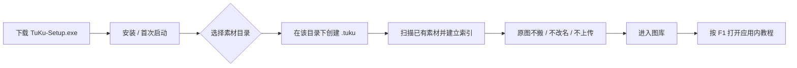
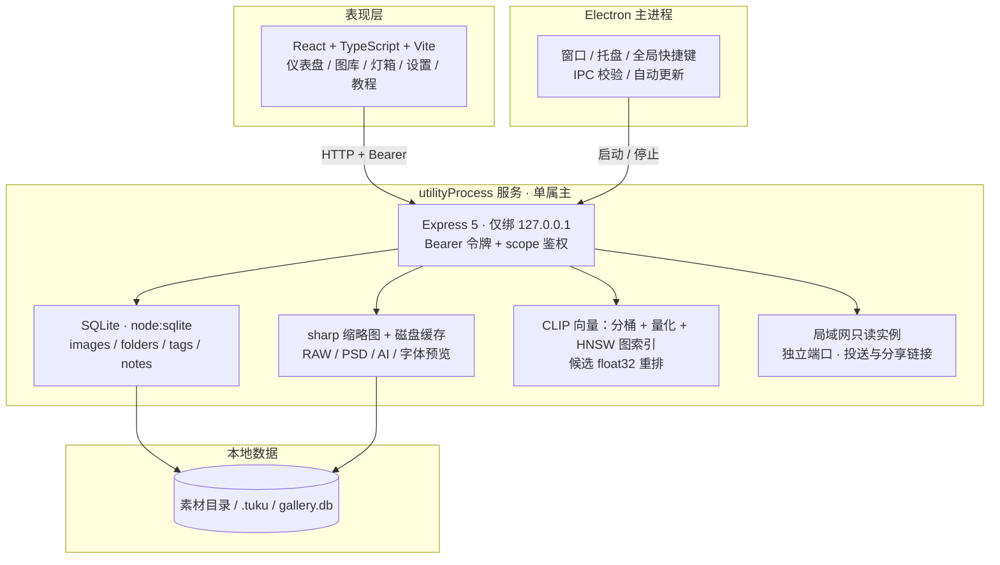
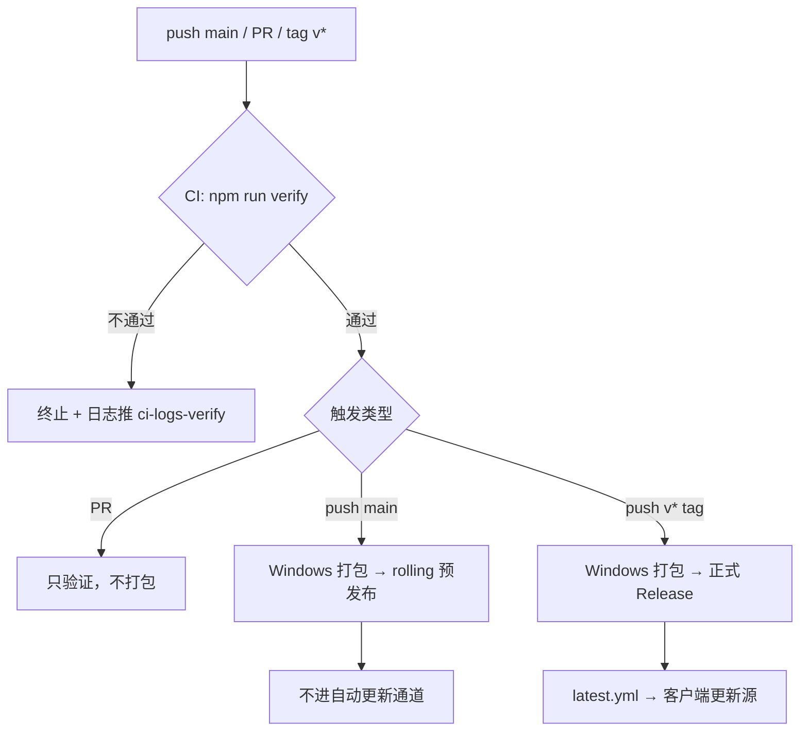

# 图库 TuKu

[](https://github.com/mr-awei/youyouvault/releases/latest)
[](#2-下载与安装)
[](#6-架构与数据流)
[](#9-常用命令)
[](LICENSE)

**本地优先的图片 / 素材管理工具。** 原图留在你自己的硬盘上，索引、标签、评分、笔记全部存在本地；不注册账号、不上传云端、断网照样能用。

> 仓库同时镜像在 [GitHub](https://github.com/mr-awei/youyouvault) 与 [Gitee](https://gitee.com/mr-awei/youyouvault)。整包自动更新只读 GitHub Releases；Gitee 仅作代码与热更镜像。
>
> 面向普通用户的功能介绍见 [`docs/产品介绍.html`](docs/产品介绍.html)。授权签发、批量授权、停用与排查见 [`docs/授权管理.md`](docs/授权管理.md)。

---

## 目录

| | | |
| --- | --- | --- |
| [1 它是什么](#1-它是什么) | [2 下载与安装](#2-下载与安装) | [3 五分钟上手](#3-五分钟上手) |
| [4 功能总览](#4-功能总览) | [5 授权与版本](#5-授权与版本) | [6 架构与数据流](#6-架构与数据流) |
| [7 数据备份与迁移](#7-数据备份与迁移) | [8 目录结构](#8-目录结构) | [9 常用命令](#9-常用命令) |
| [10 验证与质量](#10-验证与质量) | [11 打包与发布](#11-打包与发布) | [12 API 与 MCP](#12-api-与-mcp) |
| [13 常见问题](#13-常见问题) | [14 边界与说明](#14-边界与说明) | [许可](#许可) |

---

## 1 它是什么

| | 图库 TuKu | 云盘 / 在线相册 | 纯文件夹 |
| --- | --- | --- | --- |
| 原图位置 | 自己硬盘，不搬不改名 | 服务商 | 自己硬盘 |
| 组织方式 | 多层文件夹 + 标签 + 堆叠 + 智能文件夹 | 目录 / 相册 | 目录 |
| 检索 | 文件名 / 标签 / OCR / 颜色 / 语义 / 相似图 | 文件名 / 少量 AI | 文件名 |
| 离线可用 | 是 | 否 | 是 |
| 桌面集成 | 托盘 / 快捷键 / 开机自启 | 无 | 无 |
| 百万级 | 是 | 依赖服务端 | 不可用 |

Windows 桌面端（Electron）＋ 本地服务（Node）＋ Web UI，同一套数据三种打开方式。面向**单机创作者**：不做账号体系、不做实时行级云合并，把系统级集成与编辑产出做深。

**不做什么**：账号体系、在线图床、实时协同编辑、跨端行级合并、云同步（只做「同步文件夹 + 版本快照」）。跨平台只保证「能启动并使用图库」，Win32 专属能力明确降级并说明原因。

---

## 2 下载与安装

从 [Releases](https://github.com/mr-awei/youyouvault/releases/latest) 下载 `TuKu-Setup-<version>.exe`（Windows 10/11，NSIS 安装包）。

- 安装版会接管常见图片 / 视频 / 音频的「打开方式」，双击图片即可用优优图库打开
- 桌面 / 开始菜单快捷方式名为「**优优图库**」；本软件有独立的应用 ID（`com.youyou.tuku.visual`）与独立的数据目录（`%APPDATA%\youyoutuku`），可以与原始图库（TuKu）**并存安装**，不会覆盖原软件的安装、快捷方式或数据
- 首次启动选择一个素材文件夹建库，**原文件不动**
- 更新在后台静默检查与下载，下载完成后才提示：**立即安装并重启** / **下次打开时安装**
- AI 能力按需下载模型（语义搜索、超分运行库），不下也能用其余全部功能
- AI 超分 / 语义检索开跑前会检查 CPU、内存、显卡，不达标弹出对照表；配置偏低但仍能试的给「仍然继续」



---

## 3 五分钟上手

| 步骤 | 动作 | 结果 |
| --- | --- | --- |
| 1 建库 | 首次启动选素材目录（如 `D:\图片`） | 库数据写到该目录 `.tuku`，原图不搬不改名 |
| 2 找图 | 顶部搜索框吃文件名 / 标签 / 描述 / OCR；筛选栏叠加类型、星级、颜色、画幅 | 支持 `tag:` `color:` `rating:>=4` `folder:` `kind:video` `is:favorite` 前缀；语义搜索走「关键词 + 向量」混合排序 |
| 3 整理 | 勾选多张 → 底部批量条；拖图到左侧文件夹归档；拖标签到图片打标；按 `F` 快速分类 | 组织关系落库，不移动原文件 |
| 4 堆叠 | 多选后建堆叠，或把图片拖到组主卡片并入 | 一组算一条，可设封面、解散 |
| 5 编辑 | 单击进大图，`←` `→` 翻页，`1`~`5` 打星；「更多」里有裁切、调色、标注、擦除修复 | 破坏性编辑会写回原图，操作前请备份 |
| 6 查教程 | `F1`，输入「堆叠」「时间点笔记」「导出」 | 命中处高亮，内容随应用更新、不依赖网络 |

---

## 4 功能总览

| 分类 | 关键能力 | 教程里搜 |
| --- | --- | --- |
| 浏览与搜索 | 瀑布流 / 网格 / 按文件夹收纳、时间线（年 → 月 → 日）、空格快速预览、搜索前缀语法、多维筛选、排序、混合检索（关键词 + 语义）、时间线与清单虚拟滚动、EPUB 阅读器、无限画布、Excel / CSV 卡片内容缩略 | `搜索语法` `时间线` `快速预览` `筛选` `画布` |
| 文件夹与标签 | 多层文件夹、拖拽排序、图标与颜色、封面与锁定、标签分组 / 合并、拖标签打标、批量创建、批量改信息（评分 / 收藏 / 标签 / 备注）、保存筛选器、智能文件夹（AND/OR 嵌套） | `文件夹` `标签` `批量改信息` `智能文件夹` |
| 堆叠与笔记 | 图片堆叠（建组 / 拖拽并入 / 合并 / 设封面 / 解散）、多条文本笔记、视频音频时间点笔记 | `堆叠` `笔记` `时间点` |
| 整理与查重 | 待整理三视图、收件箱、MD5 完全重复、pHash 相似重复、库-盘一致性、孤儿缩略图清理、缩略图失败队列 | `查重` `失配` `待整理` `收件箱` |
| 编辑与导出 | 裁切、旋转、调色、擦除修复、标注、插值增强、非破坏编辑、视频裁剪 / GIF / WebM、CSV / JSON / HTML 画廊、Eagle 库导出 | `裁切` `非破坏` `导出` |
| 导入与分享 | 本地导入（内容级去重 / 命名模板 / 断点续传 / 冲突识别）、拖拽投放、剪贴板、手机扫码投送、只读分享（有效期 / 密码 / 禁下载）、元数据 CSV 导回 | `导入` `分享` `CSV` |
| 拍摄与入库 | 条码照片自动分组、OMS 按 5 位主 SKU 回填完整编码、保存并入库（当前文件夹 → 日期 → 编码）、每个产品自己挑前五张并按所选顺序编号、产品名与编码写入标签、旧文件移到 `.stale` | `条码` `OMS` `入库` |
| 桌面与系统 | 托盘常驻、全局快捷键、开机自启、区域截图 | `托盘` `快捷键` |
| AI 与自动化 | CLIP 语义搜索、自动标签与描述、适配度评分、知识库问答、OCR、AI 多供应商、批量动作、插件脚本、MCP / API | `语义搜索` `OCR` `MCP` |
| 数据与设置 | 多资源库、同步文件夹快照、备份恢复、外键约束与完整性自检、离线授权、快捷键自定义、命令面板、日志与诊断、检查更新 | `资源库` `备份` `授权` `快捷键` `关于软件` |
| 使用统计 | 每张素材的复制 / 导出次数与最近使用时间，仪表盘「使用统计」榜 | `使用统计` |

> 表格只是索引。**每个功能的完整说明、边界与快捷键都在应用内教程里**（`F1`），并且会随版本更新。

**几条值得单独说明的能力**

- **本地优先**：库索引、缩略图、笔记、撤销记录都在素材目录的 `.tuku` 下，原图始终在原路径。
- **百万级设计**：worker 池 + 批量事务 + 单次解码 + 增量扫描；向量检索在中等规模走 HNSW，越界退回分桶扫描。
- **非破坏编辑**：打开后裁切 / 旋转 / 调色只记录操作链，原文件一个字节都不动；可随时还原或应用到底片。
- **可观测**：失败必须有提示或日志，删除失败、模型哈希写入失败、切库后代理失败都会明确报出。
- **插件是能力白名单**：独立子进程、只拿素材快照，写库需声明 `image:write` 且只允许 tags / note / rating / favorite；不是 OS 沙箱。

---

## 5 授权与版本

> 1.5.0 起，**新签发的授权码**统一为「一个授权码 = 一个手机号 + 一台设备」。同一台设备多人使用时，每个人有各自的授权码；取消其中一条不影响同设备的其他手机号。

### 5.1 免费版与专业版

免费版开放全部基础能力（浏览、整理、搜索、堆叠、笔记、基础查看等）。以下能力需要专业版：

| 能力 | 内部 key | 说明 |
| --- | --- | --- |
| 局域网投送与只读分享 | `lan` | `/api/lan` |
| 插件脚本执行 | `plugins` | 插件运行入口 |
| AI 夜间批处理 | `night-batch` | `/api/night-batch` |
| 条码分文件夹与产品图上传 | `barcode` | `/api/barcode` |
| 时间线 | `timeline` | `/api/timeline` |
| 无限画布 | `canvas` | 前端页面 |
| 调色 / 裁切 / 修图 | `edit` | 图像编辑接口 |
| 批量编辑 / 导出 / 增强 / 动作 | `batch` | `/api/enhance`、`/api/export`、`/api/tidy`、批量动作 |

未授权时受控接口返回 `402`，不会静默失败：

```json
{
  "error": "「局域网投送与只读分享」需要专业版授权，请在「设置 → 授权」中激活",
  "code": "license_required",
  "feature": "lan"
}
```

### 5.2 授权码怎么绑定

- **一对一是唯一口径**：授权码里同时签了手机号和设备码，换机器验不过。
- **同一台设备多人使用**：每个手机号各签一张，各自独立；取消某一条只停用「手机号 + 设备码」这一对。
- **一个手机号多台设备**：逐台签发，每台一张授权码。**批量授权必须逐行成对**，不能一个手机号扇出多台设备。
- **设备码**：形如 `TK2-D0C4-0D13-4FD5-0000-0E3F-A04D`，由 6 组硬件特征各取 SHA-256 前 4 位组成：SMBIOS UUID、主板 + BIOS 序列号、启动盘物理序列号、TPM 背书密钥、Windows `MachineGuid`、CPU / 物理网卡。读不到的项显示 `0000` 且不参与比对。
- **容错**：可读 5 组及以上时允许变 2 组，少于 5 组时只允许变 1 组，并且至少命中 1 个强特征（UUID / 主板 / 启动盘 / TPM）。换单块硬盘或网卡、重装系统通常不用重签；换主板等主要硬件需要重签。
- **旧授权兼容**：旧版 16 位设备码（`XXXX-XXXX-XXXX-XXXX`）只用于校验已售旧授权，不再用于新签发。

### 5.3 激活与客户端安全

- 激活时在**本机**用内置公钥做 Ed25519 验签，并校验产品、设备码和有效期；不联网。
- **登录入口**：右上角头像 → **登录 / 激活授权**。账号就是 OMS 业务中台（`https://sit.uyoyous.com/oms-test-ui/login?redirect=/index`）的账号，密码由服务端提交给该网站的登录接口验证：成功即登录，失败原样显示网站的错误文案。账号密码只保存在本机 `data/oms-account.json`，不回传前端、不上传云端。
- **Pro 条件**：OMS 会话有效 **且** 本机有验签通过的授权码，并且授权手机号与 OMS 账号一致 → 专业版全部功能；只登录未激活、或只激活未登录、或两边手机号不一致，都按免费版运行。7 天试用期与未打包的开发模式不受此限制。
- **会话过期**：OMS token 到期或网站返回 401 时会清掉本地会话，**自动退回免费版**；重新登录成功后立即恢复专业版（无需重启）。右上角头像未登录时显示「未登录 / 免费版」。
- **入口补充**：授权码仍在「设置 → 授权」里粘贴；未登录时头像也会标成「未登录 / 免费版」。
- 授权文件写在用户数据目录 `data/license.key`，跨资源库共用；「取消授权」只删这个文件，不影响用户手里的激活码。
- 激活码格式为 `TUKU1.<payload>.<signature>`；客户端会先检查外形，再要求 `licensedByKey === true` 才提示成功。
- 除验签外还有这些校验：激活码总长度、payload JSON 长度、签名长度（Ed25519 固定 64 字节）、产品标识、授权版本、到期时间。
- **验签器负向自检**：启动时用一段格式正确但签名错误的授权码做探针。如果验签逻辑被改成「永远返回 true」，自检失败，整个授权模块按免费版运行。
- **打包版忽略测试开关**：`TUKU_DEV_PRO` 已不参与任何判断；`TUKU_LICENSE_PUBLIC_KEY`、`TUKU_LICENSE_REVOKE_DISABLE`、`TUKU_STRICT_LICENSE`、`TUKU_TRIAL_DISABLE` 只在未打包的开发 / CI 环境生效。打包后不能用环境变量打开 Pro、替换公钥或关闭停用校验。

### 5.4 试用与开发环境

- **每台设备首次安装 7 天试用**：从首次启动起算，期间可使用全部专业版能力；到期自动退回免费版，不锁软件。
- **未打包的开发环境默认拥有全部专业版能力**，用于开发调试；这不是真实授权，设置页会标注「开发模式 Pro」。
- 需要按正式授权规则测试免费版限制时：

  ```bash
  TUKU_STRICT_LICENSE=1 TUKU_TRIAL_DISABLE=1 npm run dev
  ```

  `npm run smoke` 已自行设置这两个变量，并注入一次性测试密钥对。

### 5.5 远程停用

- 停用清单由发行方私钥做 Ed25519 签名，客户端用同一把公钥验签。
- 清单包含 `revokedPhones`（按手机号整体停用）、`revokedMachines`（按设备整体停用）、`revokedPairs`（按「手机号|设备码」精确停用）。
- 客户端启动时、之后每 30 分钟、以及激活 / 取消授权后刷新时拉取清单；默认地址是 Gitee 上的 `docs/license/license-revoke.json`。拉取失败后最多每分钟重试一次。
- **只有明确命中停用记录才会整体锁定数据接口**。连不上清单、HTTP 错误或验签失败时，只退回免费版并在设置页说明原因；网络恢复后自动恢复专业版。
- 免费版未安装授权，不会因为断网被锁。

### 5.6 授权管理工具

日常签发、取消、恢复、停用手机号与清单发布，统一使用本地工具 `tools/license-admin`：

```bash
npm run license:admin          # 浏览器版（只监听 127.0.0.1，启动时打印带 token 的地址）
npm run license:admin:app      # Electron 窗口版
npm run license:admin:dist     # 打包成可双击的 exe
```

打包产物在 `release-build/license-admin/TuKu-LicenseAdmin-<版本>.exe`。工具包含「授权 / 已授权 / 已停用」三个页签，支持单个授权、逐行成对的批量授权、多选批量取消 / 恢复、停用手机号，以及明亮 / 黑暗 / 跟随系统主题。完整的操作步骤与故障排查见 [`docs/授权管理.md`](docs/授权管理.md)。

---

## 6 架构与数据流



**四条设计原则**

| 原则 | 落地方式 |
| --- | --- |
| 进程隔离 | 服务跑在 `utilityProcess` 子进程，崩溃不拖死界面；退出前先停服再关窗；主进程不直接引用 `server/db.js` |
| 百万级 | 分页查询 + 覆盖索引 + 缩略图懒加载；导入用 worker 池、批量事务、单次解码、增量扫描；向量检索在中等规模走 HNSW，越界退回分桶扫描 |
| 可观测 | 失败必须有提示或日志，禁止 `catch` 之后静默放行；新增写入路径必须同时给出失败反馈 |
| 安全 | 本地 API 令牌每次启动生成；IPC 校验窗口与 origin；`?token=` 仅限 GET；插件是能力白名单而非 OS 沙箱 |

**前端结构**：`App.tsx` 只做编排与 JSX，状态与弹窗按领域下沉到 `web/src/hooks/` 与 `web/src/app/`；低频页面全部 `React.lazy` 分包，3D 与 Office 预览按需加载。

---

## 7 数据备份与迁移

- 库索引、缩略图、笔记、撤销记录都在素材目录的 `.tuku` 下；**原图始终在原路径**。
- 换机 / 换硬盘：把整个素材目录（含 `.tuku`）复制过去，再在应用里重新指定即可。
- 只想搬组织关系：用「备份 / 恢复」导出库索引与设置（不含原图）；恢复会按新根目录重映射，并把缺失文件单独列出来。
- 数据库升级在事务里执行、失败整体回滚，并会先留一份 `gallery.db.bak-v<版本>-<日期>` 快照。
- 缩略图按需生成，删掉可重建，不影响原图。
- **文件出口必须允许点目录**：`.tuku` 以点开头，静态服务需 `dotfiles: allow`，否则缩略图全部 404。

```
素材目录/
├── .tuku/                 库数据（随素材目录一起搬走）
│   ├── gallery.db         SQLite 索引（多库各自独立）
│   ├── thumbs/            缩略图与预览缓存（可重建）
│   └── settings/          库级设置
├── 设计稿/                原图，不搬不改名
└── 照片/
```

---

## 8 目录结构

```
electron/          Electron 主进程、预加载桥、托盘、自动更新（全部 // @ts-check）
server/            本地服务：Express 路由、SQLite、缩略图、导入、AI、MCP
  routes/          按领域拆分（organize / stats / collections / export / lan …）
  lib/             可复用逻辑（query / tags / stacks / clip / hnsw / license …）
  model-pins.json  模型与运行库的可信 sha256 清单（随包只读）
web/src/           React 前端
  hooks/           列表 / 统计 / 文件夹 / 选择 / 灯箱 / 键位等 hook
  pages/           仪表盘、图库、清单、教程、设置…
  components/      卡片、灯箱、对话框、文件夹卡片…
  lib/             快捷键、路由、视频取帧、教程内容
plugins/           随包官方插件（plugin.json + ESM 入口）
assets/samples/    示例素材（随安装包分发到 samples/）
test/              单测（node:test）
scripts/           冒烟、基准、发布、授权 CLI、构建脚本；lint.mjs 负责类型闸守门
tools/license-admin/  本地授权管理工具（网页 + Electron 窗口）
docs/
  产品介绍.html     面向用户的功能介绍
  授权管理.md       签发 / 批量签发 / 停用 / 排查手册
  license/license-revoke.json  已发布的签名停用清单
```

---

## 9 常用命令

需要 Node.js ≥ 22.5（`node:sqlite` 为实验特性，启动时的 `ExperimentalWarning` 属正常）。

```bash
npm ci
npm run dev        # 后端(3001) + Vite(5173) + Electron 一起起
npm run dev:web    # 只起后端与网页（浏览器打开 5173 调试）
npm start          # 只跑本地服务（默认 3001），用已构建的 dist/web
```

| 脚本 | 说明 |
| --- | --- |
| `npm run build` | 构建前端到 `dist/web` |
| `npm run typecheck` | 四段 tsconfig 全量类型检查（Web / Node / 纯函数库 / server-lib） |
| `npm run lint` | ESLint + 自定义语法检查 + 类型闸 pragma 校验 |
| `npm run unit` | Node 原生 test runner |
| `npm run smoke` | 接口冒烟（会起临时服务，含免费版 402 → 激活 → 专业版放行链路） |
| `npm run bench` | 性能基准：临时库灌数据后打真实接口取 p50 / p95 |
| `npm run bench:quick` | 小规模快速版，已接入 `verify` |
| `npm run verify` | lint + typecheck + unit + smoke + bench:quick + 手工脚本登记 + 文档统计（CI 同款） |
| `npm run dist` | 构建并打 Windows 安装包（`release-build/`） |
| `npm run dist:secure` | 发布用：混淆 `electron/` + `server/` 后再打包，结束后自动还原源码 |
| `npm run obfuscate:restore` | 从 `.obfuscate-backup/` 还原被混淆的源码 |
| `npm run license:admin` | 打开本地图形化授权管理工具（浏览器） |
| `npm run license:admin:app` | 以 Electron 窗口打开授权管理工具 |
| `npm run license:admin:dist` | 打包可双击的 `TuKu-LicenseAdmin-<版本>.exe` |
| `node scripts/make-hotfix.mjs --notes "..."` | 打热更包（输出到 `release-build/hotfix/`） |
| `npm run mcp` | 启动 MCP stdio 服务 |
| `npm run import` | 命令行导入本地目录 |
| `npm run pin-models` | 把已验证的模型 / 运行库哈希写进 `model-pins.json` |

显卡后端排查：`TUKU_FORCE_CPU=1` 可强制 CPU 推理。DirectML 在个别驱动组合上会让进程直接退出；服务在建显卡会话前会先落一个 `probing` 标记，崩溃后下次启动自动降级 CPU 并把结论写进 `data/ai/device-state.json`；升级显卡驱动后删掉该文件即可重试。

---

## 10 验证与质量

| 环节 | 命令 | 说明 |
| --- | --- | --- |
| 静态检查 | `npm run lint` | ESLint + 语法闸；`electron/**`、`server/lib/**`、`server/routes/**` 缺 `@ts-check` 直接失败 |
| 类型 | `npm run typecheck` | Web / Node / 纯函数库 / server-lib 四套 tsconfig 通过 |
| 单测 | `npm run unit` | 鉴权、颜色搜索、CLIP 索引、HNSW 召回、RAW/PSD、模型清单、LAN、回收站、授权等 |
| 冒烟 | `npm run smoke` | 含授权激活链路、免费版受控能力返回 402 |
| 基准 | `npm run bench:quick` | 快速回归，拦截数量级回退 |
| 人工清单 | `npm run verify:manual` | 检查手动脚本登记是否齐全 |

`npm run verify` 是发版前的唯一准绳，CI 跑同一套脚本。

**类型闸怎么工作**：`tsconfig.node.json` 的 `checkJs` 仍是 `false`，因此采用**逐文件 `// @ts-check`**。`web/src` 由 `tsconfig.json` 原生检查；`electron/**`、`server/lib/**`、`server/*.js`、`server/routes/**` 全部要求 pragma；纯函数库走 `tsconfig.lib.json`。漏写 pragma = lint 失败。

> **CI 门槛口径**：GitHub Actions 是共享 runner，单核时延波动大，绝对 p95 门槛在 CI 中放宽 3 倍（输出里会标 `CI×3`）。CI 失败时，`verify-out.txt` 会推到 `ci-logs-verify` 分支，`build-out.txt` 推到 `ci-logs` 分支，本地 `git fetch origin <分支> && git show origin/<分支>:<文件>` 即可取日志。

---

## 11 打包与发布

```bash
npm run dist -- --publish never      # → release-build/TuKu-Setup-<version>.exe
npm run dist:secure                  # 发布用：混淆 electron/ + server/ 后再打包
```

### 11.1 安全打包做了什么

`npm run dist:secure` 会：

1. 用 esbuild 压缩 `electron/` 与 `server/` 下的所有 JS / MJS / CJS；
2. 对 `server/lib/license.js` 与 `server/lib/license-core.js` **额外**做字符串加密、Base64 编码、控制流扁平化和 self-defending 混淆；
3. 调用 `npm run dist -- --publish never` 打包；
4. 无论成功失败，最后都从 `.obfuscate-backup/<时间戳>/` **自动还原源码**。

- 打包被中断、源码停在混淆状态时：`npm run obfuscate:restore`
- 本地调 Bug 时跳过混淆：`TUKU_SKIP_OBFUSCATE=1 npm run dist`
- 混淆只能提高逆向成本，**客户端离线授权无法做到绝对不可破解**；真正的边界是私钥绝不入包、公钥随包发布、停用清单需要签名。

### 11.2 授权管理工具打包

```bash
npm run license:admin:dist
```

- 产物：`release-build/license-admin/TuKu-LicenseAdmin-<版本>.exe`，双击直接打开窗口
- 主进程、管理服务、授权核心用 esbuild 打成一个 ESM 文件，不依赖仓库 `node_modules`
- 在仓库外临时目录打包，避免把主项目的 sharp / onnxruntime / react 误装进去
- 首次运行找不到私钥会弹窗选择 `.license-private.pem`，导入后保存到用户数据目录
- 可用 `TUKU_LICENSE_ADMIN_OUT` 改输出目录，`TUKU_KEEP_ADMIN_BUILD=1` 保留临时构建目录

### 11.3 CI 流程



| 触发 | 结果 |
| --- | --- |
| PR | 跑完整 `npm run verify`，只验证、不打包 |
| push `main` | 安装包挂到固定 tag `rolling` 的**预发布**，不进自动更新通道 |
| push `v*` 标签 | 构建安装包 → 正式 Release → 成为客户端更新源 |

### 11.4 发版步骤

```bash
# 1. 升版本（不自动打 tag）
npm version patch --no-git-tag-version   # 本次 1.5.8 用 patch；功能版本用 minor
# 2. 全量验证
npm run verify
# 3. 提交
git add -A && git commit -m "feat: vX.Y.Z ..."
# 4. 打 tag 并点名推送（不要用 --tags）
git tag vX.Y.Z
git push origin main vX.Y.Z      # GitHub → 触发 CI 出正式 Release
git push gitee main vX.Y.Z       # Gitee → 仅代码镜像
# 5. 本地出包
npm run dist -- --publish never
```

> **不要用 `git push --tags`**：本地若残留陈旧的 `rolling` tag，远端同名 tag 由 CI 每次重建，整条命令会报 `already exists` 并失败。点名推具体 tag 最稳。
>
> **tag 构建失败会断掉更新源**：`releases/tags/vX.Y.Z` 会 404。修完 CI 后把 tag 前移到修复提交并 `git push -f origin refs/tags/vX.Y.Z` 重新触发；`workflow_dispatch` 只出 rolling 预发布，不能替代。
>
> **本地打包环境**：先删净整个 `release-build/` 输出目录；国内网络设 `ELECTRON_MIRROR=https://npmmirror.com/mirrors/electron/`；360「主动防御」可能锁住 `default_app.asar`，出现 `EBUSY` / `EPERM` 时再关闭它。

### 11.5 热更

改的是 `server/**` 或前端产物时，可用签名热更包叠在安装包之上运行，不必重新覆盖安装。

```bash
npm run build
node scripts/make-hotfix.mjs --notes "修导出首帧闪回"
# 或走 CI：Actions → hotfix → Run workflow（notes 必填）
```

| 能热更 | 不能热更（必须发安装包） |
| --- | --- |
| `server/**`（接口、导出、AI 调度） | `electron/**`（主进程、preload、窗口） |
| `web/**`（前端产物，含增量资源） | `package.json`、原生模块（`*.node`）、插件二进制依赖 |
| 文案、样式、图标等静态资源 | 需要新数据库迁移的改动 |

热更清单用 Ed25519 签名，防降级靠 `seq` 严格递增、`shellVersion` 与 `schemaVersion` 对齐。**不要通过热更替换授权逻辑或公钥**，否则会出现「同一个版本、两台机器行为不同」的排查噩梦。

---

## 12 API 与 MCP

### 12.1 授权接口

| 方法 | 路径 | 说明 |
| --- | --- | --- |
| `GET` | `/api/license` | 当前状态；`?refresh=1` 重新探测硬件并强制刷新停用清单 |
| `POST` | `/api/license/activate` | body `{ "key": "TUKU1..." }` |
| `POST` | `/api/license/deactivate` | 删除本机授权文件（不影响已购买的授权码） |

### 12.2 开放 API 与 MCP

- `/api/v1` 是稳定契约，`Authorization: Bearer` + `read` / `write` / `ingest` 三级 scope
- 自带 OpenAPI 3.0 文档（`/api/v1/openapi.json`）、每分钟 120 次限流、审计日志不含令牌明文
- 附加令牌写在用户数据目录 `api-tokens.json`，或用 `TUKU_API_SCOPE_TOKENS` 注入
- 本地 API 的启动令牌每次启动重新生成；`?token=` 仅允许 GET，写操作必须走 header
- `/api/docs` 返回结构化路由清单，`/api/docs.md` 可整份导出

`npm run mcp` 启动 stdio MCP 服务（零依赖，JSON-RPC 2.0）：

| 工具 | 作用 |
| --- | --- |
| `search_images` | 按关键词 / 条件搜图 |
| `list_favorites` | 列出收藏 |
| `list_smart_folders` | 列出保存的筛选器 |
| `apply_smart_folder` | 应用某个保存的筛选器 |
| `get_library_stats` | 读取库统计 |

---

## 13 常见问题

<details>
<summary><strong>Q：断网还能用吗？</strong></summary>

能。检查更新失败不锁界面；授权验签在本地完成。已安装真实授权时，断网拉不到停用清单只会退回免费版，网络恢复后自动恢复专业版，不会整体锁软件。
</details>

<details>
<summary><strong>Q：卸载或删库会删我的图片吗？</strong></summary>

不会。卸载、更新、删除资源库都只动程序与库索引；原图在素材目录里。回收站的彻底清除是否删原文件，取决于设置里的删除行为。
</details>

<details>
<summary><strong>Q：有的图显示不出来？</strong></summary>

大概率是文件在应用外被改名 / 移动 / 删除，或库目录换了盘符。先跑「库-盘一致性检查」重新关联，别急着重新导入（重导会丢评分与标签）。
</details>

<details>
<summary><strong>Q：为什么堆叠后总张数变少了？</strong></summary>

堆叠按一条统计：3 张同组素材在图库里显示 1 条。展开堆叠能看到全部成员；解散后张数恢复。
</details>

<details>
<summary><strong>Q：拖拽为什么没反应（桌面端）？</strong></summary>

桌面端默认拖拽是「拖出成文件」。应用内叠堆请按住 `Alt` 拖；手动排序模式下拖拽是调整顺序。
</details>

<details>
<summary><strong>Q：激活码提示「与当前设备不符」？</strong></summary>

让用户重新复制「设置 → 授权」里的 `TK2-` 设备码。换过主板等主要硬件、或 6 组里变化超过容错范围时，需要按新设备码重新签发。
</details>

<details>
<summary><strong>Q：一台电脑多人使用，授权怎么算？</strong></summary>

每个手机号各签一张授权码，绑定同一个设备码。取消其中一条只影响该手机号，同一台设备上的其他人不受影响。
</details>

<details>
<summary><strong>Q：提示「无法连接授权服务器」是被停用了吗？</strong></summary>

不是。这只表示本次停用清单拉取失败，当前按免费版运行；只有清单里明确命中该手机号 / 设备 / 「手机号 + 设备码」时才会整体锁定。
</details>

<details>
<summary><strong>Q：模型下载失败 / 提示校验不通过？</strong></summary>

下载按随包清单比对 sha256，不符会删包并报「可能被替换」。先确认网络能访问镜像，重试一次；仍失败时日志里会写明是体积异常、签名不符还是哈希不匹配。
</details>

<details>
<summary><strong>Q：日志在哪？</strong></summary>

`%APPDATA%\youyoutuku\logs\`，也可以在设置 → 关于软件 → 目录与诊断里直接打开日志与崩溃转储目录。
</details>

<details>
<summary><strong>Q：数据能搬到另一台机器吗？</strong></summary>

把素材目录连同 `.tuku` 一起拷走最省事；只想搬组织关系就用「导出 → 恢复」（不含原图）。
</details>

---

## 14 边界与说明

| 主题 | 如实说明 |
| --- | --- |
| 离线授权的极限 | 客户端验签能挡住「拷一份 key 到别的电脑」，但挡不住改二进制或整机克隆。真正的强控制依赖持续更新、停用清单与正版体验 |
| 私钥与公钥 | 私钥只在本机与 CI secret，绝不入包；公钥随包发布，已在线上使用的公钥不要更换，否则老安装包无法激活新码 |
| 混淆不是加密 | `dist:secure` 提高逆向成本，不改变安全边界；授权、停用与 Pro 能力闸仍在本地授权层 |
| 停用依赖联网 | 明确停用后，客户端需要能拉到签名清单才会锁定；完全离线且从未联网的机器无法感知新停用 |
| 验证覆盖不等于无缺陷 | `npm run verify` 全绿只证明已写进测试的路径没坏；`server/routes/**` 并非每条都有直接测试 |
| AI 是可选能力 | 本地模型需下载，云端需自填密钥；模型缺失时功能明确置灰或报错，不给假结果 |
| 模型硬件门槛 | AI 超分、语义检索都是本地推理，开跑前按「最低要求」检查 CPU / 内存 / 显卡；配置偏低给「仍然继续」，确定跑不了的才硬拦 |
| 增强不是超分 | 画质增强是插值放大；擦除修复是内容感知扩散，不是生成式 AI |
| 云同步口径 | 只有「同步文件夹 + 版本快照」，没有在线账号与实时行级合并；两端显式发布 / 拉取，冲突明确报出 |
| 地图 / GPS 未做 | 不解析 EXIF 的 GPS，也没有地图视图或按地点筛选 |
| 备份不含原图 | 导出的是库索引与设置 |
| 插件不是沙箱 | 能力白名单只能限制写库字段，不能隔离文件系统；只装自己信任的插件 |
| 跨平台 | Windows 为完整能力；macOS / Linux 配置了打包目标，保证「能启动并使用图库」，Win32 专有能力会明确降级并说明原因 |
| 安装包签名 | 当前安装包未做代码签名，Windows 可能提示「未知发布者」 |
| 强制更新 | 正式 Release 即更新源。下载完成后由你二选一：「立即安装并重启」/「下次打开时安装」。离线环境可用 `TUKU_FORCE_UPDATE=off` 自行构建 |
| 编辑是否改原图 | 默认「存副本」；打开非破坏性编辑后，裁切 / 旋转 / 调色只记操作链。增强 / 超分这类即时动作仍会写回原图，动手前请自行备份 |

---

## 许可

本项目为**专有软件，保留所有权利**（All Rights Reserved）。源码公开在 GitHub / Gitee，仅供查看、学习与安全审计；**未授予任何开源许可**，未经书面授权不得复制、修改、分发、商用或再发布。完整条款见根目录 [LICENSE](LICENSE)。
